<!--
  Profile README for github.com/ismoillooff.
  The cards in assets/ are generated by scripts/generate.py from the GitHub API
  (public + private repositories, aggregated) and refreshed daily by
  .github/workflows/profile.yml. Edit scripts/profile.config.json, not the SVGs.
-->

<a href="https://ismoillooff.uz">
  <picture>
    <source media="(prefers-color-scheme: dark)" srcset="assets/hero-dark.svg">
    
  </picture>
</a>

  
  
  
  
  

## 👋 About me

I build business software end to end for companies in Uzbekistan — **CRM / ERP and POS systems, multi‑tenant EdTech SaaS, e‑commerce, Telegram bots & Mini Apps, and AI agents** that talk to real customers. I own the whole path: requirements → architecture → backend & frontend → payments → deployment, backups and documentation.

- 🏢 **Founder** of [MyWeb](https://github.com/ismoillooff/MyWeb) & [Nyro Soft](https://github.com/ismoillooff/Nyro-Soft) · **Team Lead** at Maxshi Shop · **Full‑Stack Engineer** at MYPRO & MYCOM
- 🔭 Now building **EduTester V2** — multi‑tenant LMS for education centers — and the **Con‑Dor ERP** finance module
- 🌱 Going deeper into **multi‑agent systems, MCP and Claude Code tooling**, and Flutter
- 💬 Ask me about **Django / DRF, FastAPI, React + TypeScript, CRM/ERP design, Telegram bots, Payme / Click, uz / ru localization**
- ⚡ Fun fact: I ride motorcycles — and build software for motorcycle shops 🏍️

## 📊 GitHub analytics

<picture>
  <source media="(prefers-color-scheme: dark)" srcset="assets/stats-dark.svg">
  
</picture>

  <picture>
    <source media="(prefers-color-scheme: dark)" srcset="assets/languages-dark.svg">
    
  </picture>
  <picture>
    <source media="(prefers-color-scheme: dark)" srcset="assets/focus-dark.svg">
    
  </picture>

<picture>
  <source media="(prefers-color-scheme: dark)" srcset="assets/activity-dark.svg">
  
</picture>

<picture>
  <source media="(prefers-color-scheme: dark)" srcset="https://raw.githubusercontent.com/ismoillooff/ismoillooff/output/snake-dark.svg">
  
</picture>

## ⭐ Featured projects

  <a href="https://github.com/ismoillooff/Mobile-Preview"><picture><source media="(prefers-color-scheme: dark)" srcset="assets/cards/mobile-preview-dark.svg"></picture></a>
  <a href="https://github.com/ismoillooff/NafCrm"><picture><source media="(prefers-color-scheme: dark)" srcset="assets/cards/nafcrm-dark.svg"></picture></a>
  <a href="https://github.com/ismoillooff/Mycom-Projects"><picture><source media="(prefers-color-scheme: dark)" srcset="assets/cards/mycom-projects-dark.svg"></picture></a>
  <a href="https://github.com/ismoillooff/Con-Dor"><picture><source media="(prefers-color-scheme: dark)" srcset="assets/cards/con-dor-dark.svg"></picture></a>
  <a href="https://github.com/ismoillooff/Altima-Shop"><picture><source media="(prefers-color-scheme: dark)" srcset="assets/cards/altima-shop-dark.svg"></picture></a>
  <a href="https://github.com/ismoillooff/MyWeb"><picture><source media="(prefers-color-scheme: dark)" srcset="assets/cards/myweb-dark.svg"></picture></a>
  <a href="https://github.com/ismoillooff/seller-agent"><picture><source media="(prefers-color-scheme: dark)" srcset="assets/cards/seller-agent-dark.svg"></picture></a>
  <a href="https://github.com/ismoillooff/Telegram-Claude-Agent"><picture><source media="(prefers-color-scheme: dark)" srcset="assets/cards/telegram-claude-agent-dark.svg"></picture></a>
  <a href="https://github.com/ismoillooff/Agents-Comand"><picture><source media="(prefers-color-scheme: dark)" srcset="assets/cards/agents-comand-dark.svg"></picture></a>
  <a href="https://github.com/ismoillooff/gemini-image"><picture><source media="(prefers-color-scheme: dark)" srcset="assets/cards/gemini-image-dark.svg"></picture></a>

<b>More open-source work</b> — 17 more repositories

 

| Project | What it does | Stack |
|---|---|---|
| [Haipeng-Uz](https://github.com/ismoillooff/Haipeng-Uz) | Motorcycle e-shop, admin panel and manufacturing CRM: catalog, orders, warehouse, workers, branches, finance | React · FastAPI · SQLite |
| [kaskadyor.uz](https://github.com/ismoillooff/kaskadyor.uz) | Prerendered brand site for a Tashkent moto-gear & parts store | React 19 · Motion · nginx · Cloudflare |
| [TanishuvAi-Bot](https://github.com/ismoillooff/TanishuvAi-Bot) | Matchmaking Mini App with AI matching and Payme / Click / Stars payments | React · Vite · Vitest |
| [exe-creator-bot](https://github.com/ismoillooff/exe-creator-bot) | Telegram bot that turns a website into a fullscreen WebView2 Windows app, with Authenticode signing | Python · C# · Inno Setup |
| [sms-otp-telegram-bot](https://github.com/ismoillooff/sms-otp-telegram-bot) | Phone-number verification with SMS one-time codes | Python · aiogram 3 · Docker |
| [Asiastore-Operators](https://github.com/ismoillooff/Asiastore-Operators) | Order & sales reports from call-center operators to Telegram groups and Google Sheets | aiogram 3 · SQLite · gspread |
| [Card-Xabar](https://github.com/ismoillooff/Card-Xabar) | Userbot that parses Humo / Uzcard notifications and forwards incoming transactions | Telethon · asyncio |
| [Emoj-To-Web](https://github.com/ismoillooff/Emoj-To-Web) | 1,645 Telegram Premium custom-emoji IDs with ready-to-use code samples | Python · JSON / CSV |
| [Premium-Package-Bot](https://github.com/ismoillooff/Premium-Package-Bot) | Custom-emoji explorer that generates button code in 7 languages | aiogram 3 · pytest |
| [Profi-Perezd.uz](https://github.com/ismoillooff/Profi-Perezd.uz) | Moving-service sales site with price calculator and Telegram lead delivery | Next.js 16 · GSAP · Tailwind 4 |
| [Nyro-Soft](https://github.com/ismoillooff/Nyro-Soft) | Studio site with interactive demo and a 4-step project brief | React Router 7 · Vite 8 |
| [GeminiPro](https://github.com/ismoillooff/GeminiPro) | Uzbek-language landing page explaining Google AI Pro | React 19 · Tailwind 4 |
| [umraga-yollanma](https://github.com/ismoillooff/umraga-yollanma) | Umrah travel landing page with an admin dashboard | React · Node.js · SQLite |
| [Taxi-Bot](https://github.com/ismoillooff/Taxi-Bot) | Intercity taxi & parcel bot with driver and admin panels, 21 routes, uz / ru | PHP · MySQL · Docker |
| [Nomer-Bot](https://github.com/ismoillooff/Nomer-Bot) | Virtual numbers & SMS activation via the 5sim API, referrals and payments | PHP · Bot API |
| [UzGramBot-Nakrutka-Bot-](https://github.com/ismoillooff/UzGramBot-Nakrutka-Bot-) | SMM ordering bot and web panel with Payme top-ups | PHP · MySQL |
| [Zayafkachi-Oddiy](https://github.com/ismoillooff/Zayafkachi-Oddiy) | Auto-approves join requests in groups and channels, including the backlog | aiogram 3 · Telethon |

## 🔒 Private & commercial work

Source code for these is private (client and commercial products). Live versions are linked where they exist; details on request.

  <a href="https://edutester.uz"><picture><source media="(prefers-color-scheme: dark)" srcset="assets/cards/private-edutester-lms-dark.svg"></picture></a>
  <a href="https://con-dor.uz"><picture><source media="(prefers-color-scheme: dark)" srcset="assets/cards/private-con-dor-erp-dark.svg"></picture></a>
  <a href="https://avtotester.uz"><picture><source media="(prefers-color-scheme: dark)" srcset="assets/cards/private-avtotester-uz-dark.svg"></picture></a>
  <picture><source media="(prefers-color-scheme: dark)" srcset="assets/cards/private-asiastore-crm-dark.svg"></picture>
  <picture><source media="(prefers-color-scheme: dark)" srcset="assets/cards/private-edu-tech-dark.svg"></picture>
  <picture><source media="(prefers-color-scheme: dark)" srcset="assets/cards/private-runsmm-platform-dark.svg"></picture>

Also in progress: **BoyTerak ERP** — livestock-market ERP covering intake, slaughter, meat sales, wholesale dispatch and finance (full TZ / BRD / PRD / SRS documentation stage).

## 🌐 Live in production

| | Product | What it is | Status |
|:-:|---|---|:-:|
| 🎓 | [**EduTester**](https://edutester.uz) | LMS & CRM for education centers and driving schools |  |
| 🚗 | [**AvtoTester**](https://avtotester.uz) | Driving-licence exam preparation platform + Telegram bot |  |
| 🎒 | [**Con-Dor**](https://con-dor.uz) | Army & outdoor store chain — storefront on top of a full ERP |  |
| 🖥️ | [**MYPRO**](https://mypro.uz) | Manufacturer catalog: all-in-ones, monitors, interactive panels |  |
| 🏫 | [**JAWANTI PRO**](https://jawanti.uz) | Locally assembled PCs for schools & public procurement |  |
| 🎮 | [**ProGaming**](https://progaming.uz) | Gaming hardware storefront on the shared Django CMS |  |
| 🥾 | [**Altima Shop**](https://altimashop.uz) | Tactical & outdoor footwear store on Cloudflare Workers |  |
| 🚚 | [**Profi Pereezd**](https://profi-pereezd.uz) | Moving-service sales site with price calculator & Telegram leads |  |
| 💍 | [**Tanishuv AI**](https://t.me/TanishuvAiBot) | Marriage-focused matchmaking bot + Mini App with AI matching |  |
| 📞 | [**Asiastore Operators**](https://t.me/AsiaOperatorsBot) | Sales-report bot for call-center operators → Google Sheets |  |
| 👤 | [**Portfolio**](https://ismoillooff.uz) | Personal site — all projects and case studies |  |

## 🛠️ Tech stack

| | |
|---|---|
| **Languages** |  |
| **Frontend & mobile** |  |
| **Backend** |  |
| **Data** |  |
| **DevOps & cloud** |  |
| **Tools** |  |
| **AI & integrations** |              |

## 🤝 Let's work together

Need a CRM, an online store, a Telegram bot or an AI agent for your business? Let's talk.

  
  
  

<picture>
  <source media="(prefers-color-scheme: dark)" srcset="assets/footer-dark.svg">
  
</picture>
